

  

<h1 align="center">❄ SnowPlowing</h1>

<b>Ημερολόγια μηχανημάτων χειμερινής συντήρησης — αναφορές PDF & Excel με ένα κλικ</b>

  <a href="../../releases/latest/download/SnowPlowing.exe"><b>⬇ Λήψη SnowPlowing.exe (τελευταία έκδοση)</b></a>
  &nbsp;·&nbsp; <a href="../../releases">Όλες οι εκδόσεις</a>

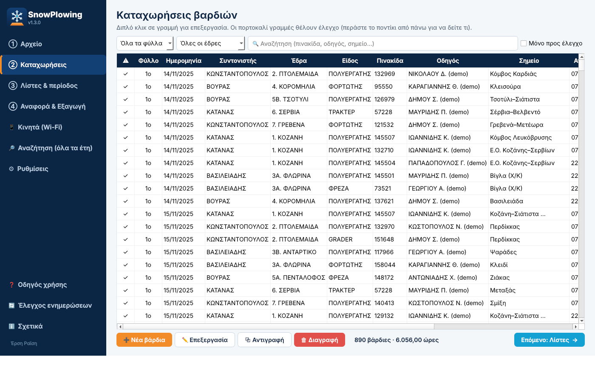

---

## Τι κάνει

- 📥 **Εισαγωγή από Excel** στη μορφή του ημερολογίου (φύλλα «1ο ΤΡΙΜ», «2ο ΤΡΙΜ», «Data»), με προεπισκόπηση πριν περάσει οτιδήποτε
- ✍️ **Καταχώρηση βαρδιών για αρχάριους**: η πινακίδα συμπληρώνει μόνη της είδος και έδρα, η έδρα τον ανάδοχο
- 🔍 **Αυτόματος έλεγχος λαθών**: άκυρες ώρες, λάθος πινακίδα ή είδος, επικαλύψεις βαρδιών, εκτός περιόδου…
- 📄 **Αναφορά PDF**: σύνοψη ανά έδρα και είδος, γραφήματα, ώρες ανά μηχάνημα, κόστος με ΦΠΑ, υπογραφές
- 📊 **Εξαγωγή Excel** στην ίδια μορφή, με τύπους, λίστες επιλογών και στήλη «Έλεγχος»
- 🗄 **Βάση δεδομένων** με όλες τις χρονιές και καθημερινά αντίγραφα ασφαλείας
- 🔎 **Αναζήτηση σε όλα τα έτη**: όνομα, πινακίδα, σημείο, ημερομηνία, αριθμός σύμβασης…
- 📱 **Καταχώρηση από κινητό** μέσω Wi-Fi ή **Tailscale από παντού (4G)** — QR code + PIN, χωρίς εφαρμογή
- 🎨 **Φωτεινό / σκοτεινό θέμα**, αυτόματα όπως τα Windows
- 💶 **Κόστος** με τιμή ανά ώρα για κάθε είδος μηχανήματος
- 🔄 **Αυτόματες ενημερώσεις**: το πρόγραμμα βρίσκει μόνο του τη νέα έκδοση

## Εγκατάσταση (3 βήματα)

1. Κατεβάστε το **[SnowPlowing.exe](../../releases/latest/download/SnowPlowing.exe)**.
2. Βάλτε το σε έναν φάκελο (π.χ. `Έγγραφα\SnowPlowing`) και κάντε διπλό κλικ.
3. Αν τα Windows δείξουν «Τα Windows προστάτευσαν τον υπολογιστή σας», πατήστε **Περισσότερες πληροφορίες → Εκτέλεση οπωσδήποτε**.

Δεν χρειάζεται τίποτε άλλο. Την πρώτη φορά υπάρχει έτοιμη μια **demo χρονιά** (με σήμανση «demo») για να δοκιμάσετε
χωρίς να μπλέξει με τα πραγματικά δεδομένα. Τη σβήνετε από ⚙ Ρυθμίσεις → «Διαγραφή demo».

## 🔏 Πιστοποιητικό εκδότη (για υπολογιστές εργασίας)

Το exe είναι υπογεγραμμένο από **ALU DEV TEAM**. Για να το αναγνωρίζουν τα Windows ως γνωστό εκδότη
αντί για «Άγνωστος εκδότης», κάντε **μία φορά** σε κάθε υπολογιστή:

1. Κατεβάστε το **[SnowPlowing_Certificate.zip](../../releases/latest/download/SnowPlowing_Certificate.zip)** και αποσυμπιέστε το.
2. Δεξί κλικ στο `Install_Certificate.bat` → **Εκτέλεση ως διαχειριστής**
   (χωρίς δικαιώματα διαχειριστή: διπλό κλικ → «Ναι»).

Το πιστοποιητικό επιτρέπεται **μόνο** για υπογραφή προγραμμάτων και δεν επηρεάζει ιστοσελίδες ή HTTPS.
Αφαιρείται με το `Uninstall_Certificate.bat`. Το τμήμα πληροφορικής μπορεί να το περάσει σε όλους με Group Policy.

## Πώς δουλεύει

| Βήμα | Τι κάνετε |
|---|---|
| ① Αρχείο | «Εισαγωγή από Excel» — μία φορά για κάθε χρονιά |
| ② Καταχωρήσεις | «Νέα βάρδια» ή διπλό κλικ για διόρθωση· οι πορτοκαλί γραμμές θέλουν έλεγχο |
| ③ Λίστες | Μηχανήματα, έδρες, τιμές €/ώρα, συμβάσεις |
| ④ Αναφορά | «Και τα δύο» → PDF + Excel στον ίδιο φάκελο |

## 🌍 Καταχώρηση από παντού με Tailscale (για αρχάριους)

Το Tailscale φτιάχνει ένα ιδιωτικό, κρυπτογραφημένο «τούνελ» ανάμεσα στο κινητό και τον υπολογιστή — χωρίς ρυθμίσεις στο ρούτερ.

**Υπολογιστής (μία φορά):** κατεβάστε το [Tailscale για Windows](https://tailscale.com/download/windows) → εγκατάσταση →
εικονίδιο κάτω δεξιά → **Log in** με Google ή Microsoft λογαριασμό.

**Κινητό (κάθε οδηγός):** Play Store / App Store → **Tailscale** → Log in με τον **ίδιο** λογαριασμό → **Connect** → OK στο VPN.

**SnowPlowing:** 📱 Κινητά → **Έναρξη** → επιλέξτε **🌍 Tailscale** → σκανάρισμα του QR → PIN.

Δεν συνδέεται; Ο υπολογιστής ανοιχτός με το SnowPlowing σε λειτουργία · Tailscale «Connected» και στα δύο ·
πατήστε «🛡 Άνοιγμα θύρας στο Τείχος». Για συναδέλφους με άλλο λογαριασμό: login.tailscale.com → Machines → ⋯ → **Share**.

## Στιγμιότυπα

| | |
|---|---|
| 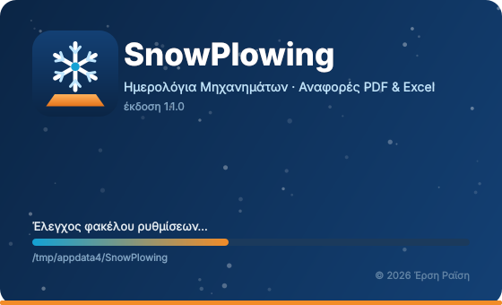 Εκκίνηση με ελέγχους | 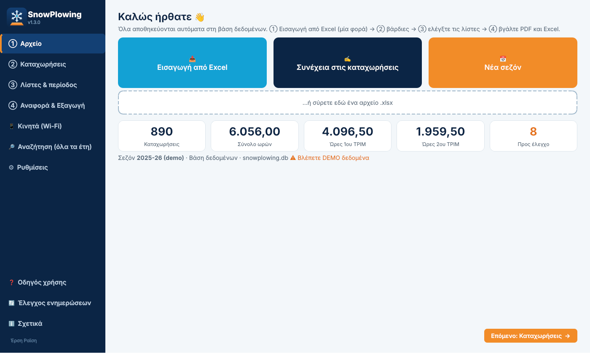 Αρχική |
| 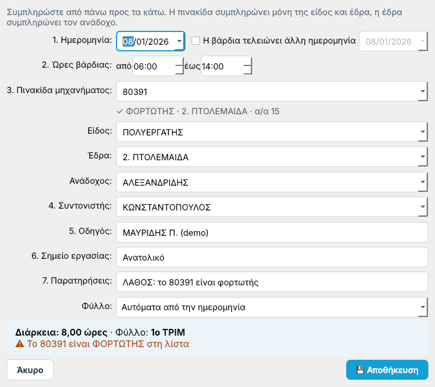 Φόρμα βάρδιας με ζωντανό έλεγχο | 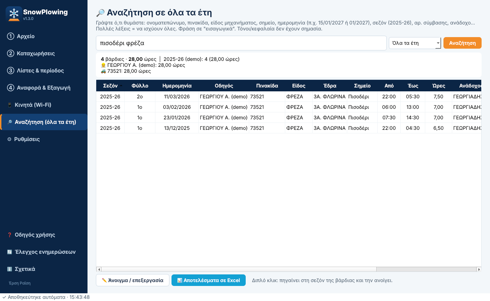 Αναζήτηση σε όλα τα έτη |
| 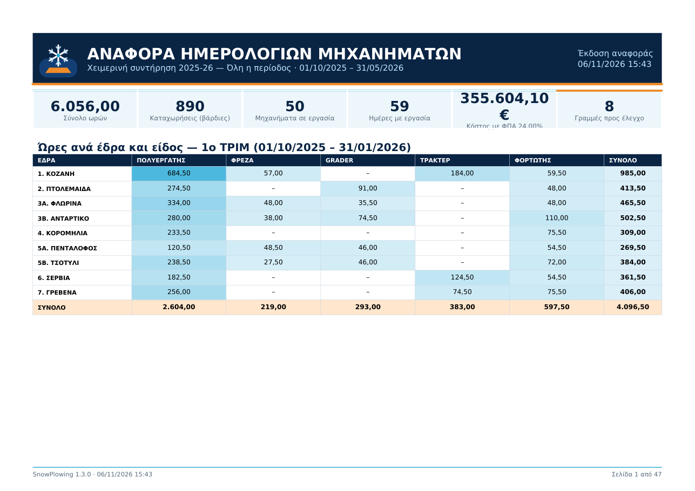 PDF — σύνοψη | 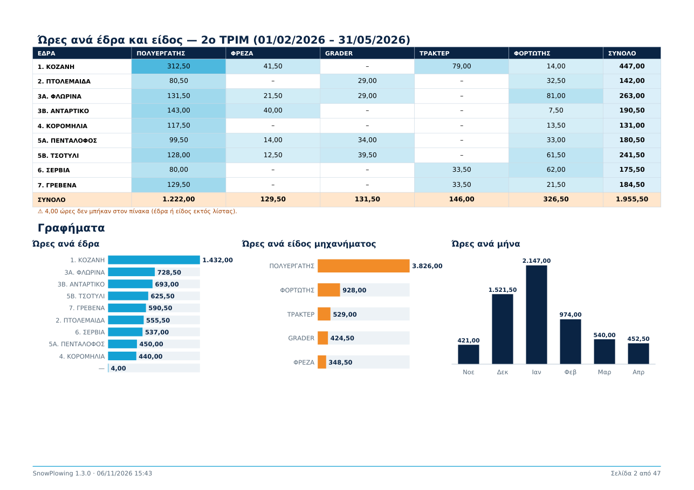 PDF — γραφήματα |
| 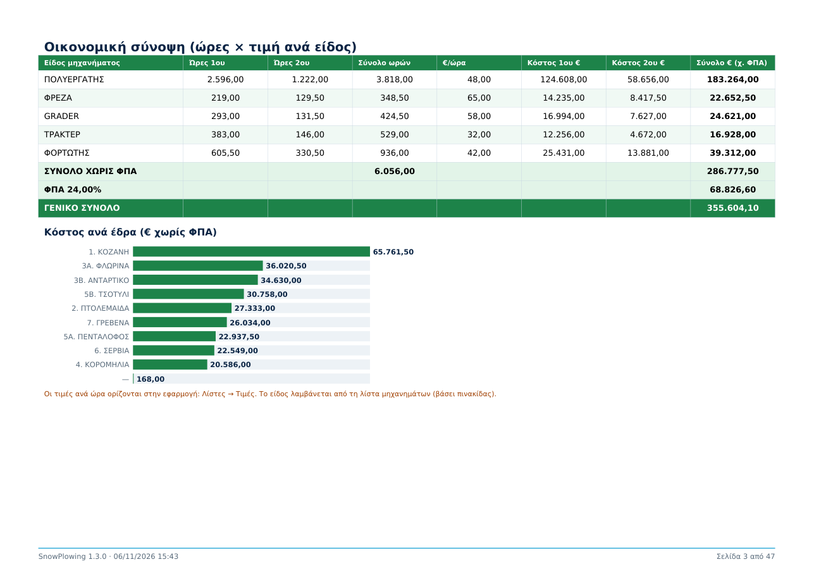 PDF — κόστος | 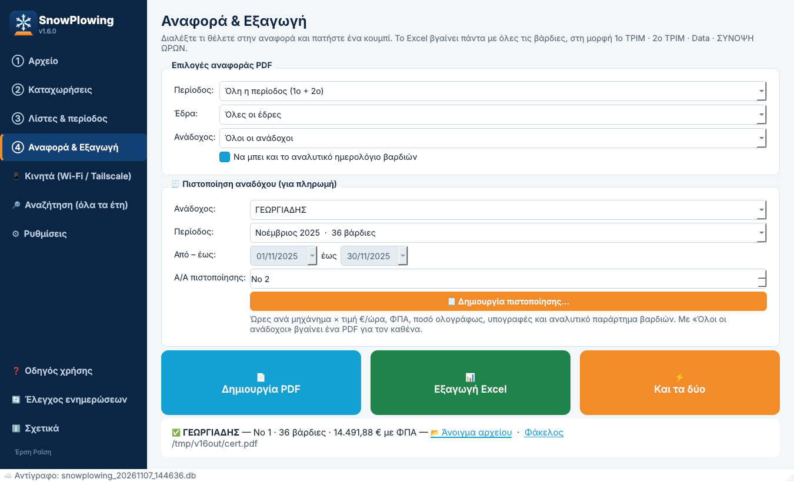 Αναφορά & εξαγωγή |
| 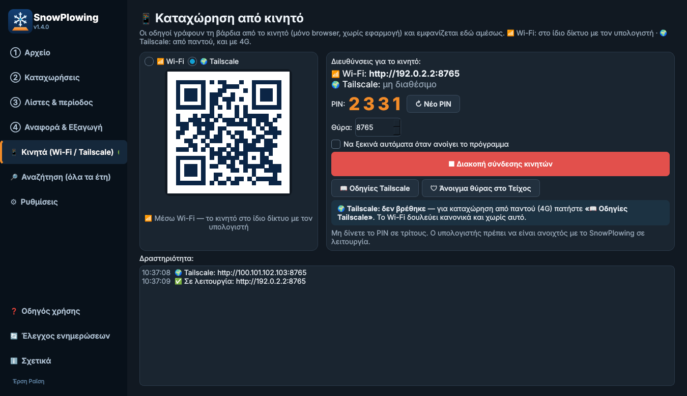 Σύνδεση κινητών: Wi-Fi ή Tailscale (QR + PIN) | 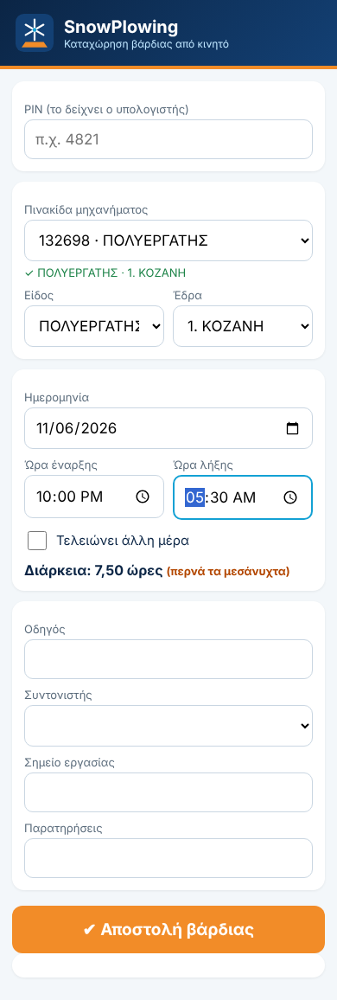 Φόρμα στο κινητό |
| 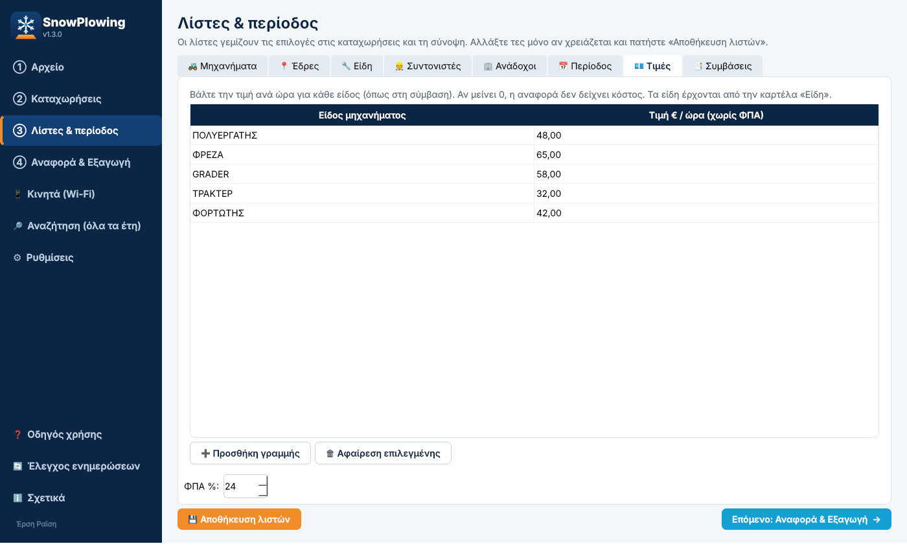 Τιμές €/ώρα & ΦΠΑ | 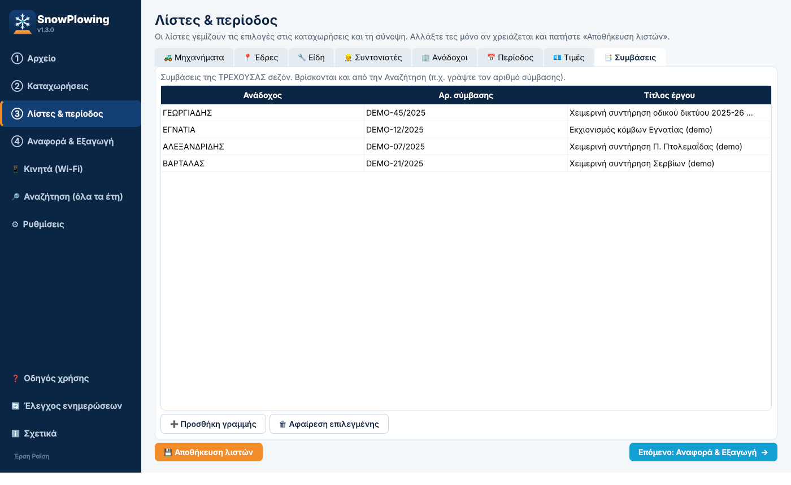 Συμβάσεις |
| 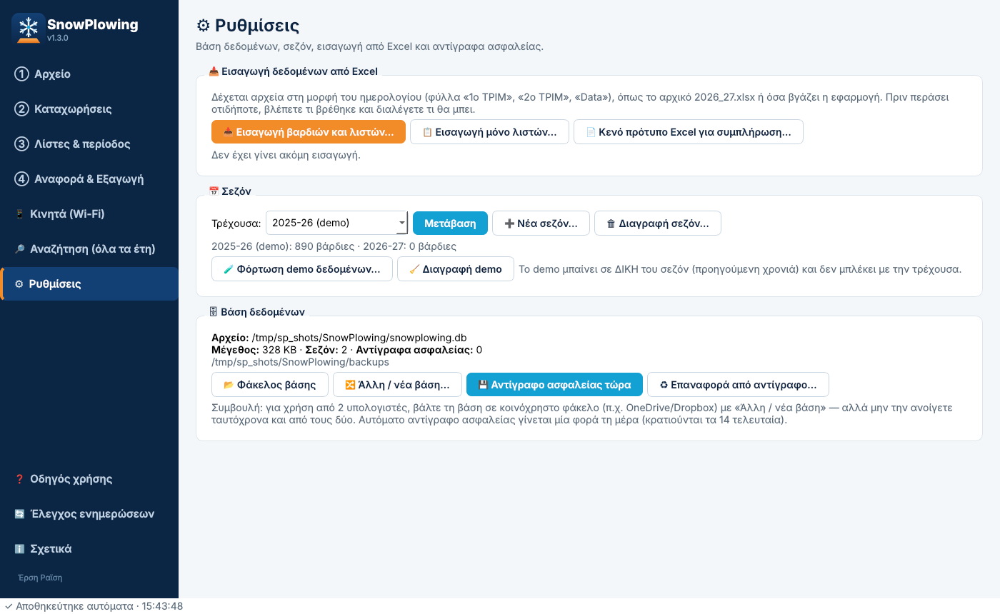 Ρυθμίσεις & βάση δεδομένων | 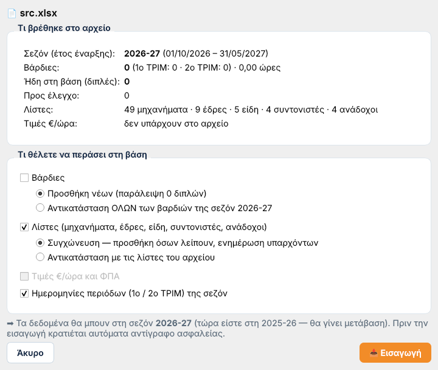 Εισαγωγή με προεπισκόπηση |
| 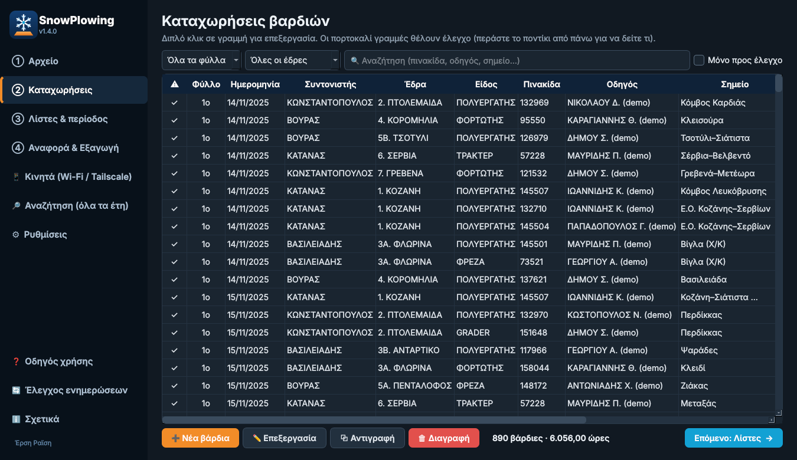 Σκοτεινό θέμα | |

## Συχνές ερωτήσεις

**Πού αποθηκεύονται τα δεδομένα;** Στον υπολογιστή σας, σε `%APPDATA%\SnowPlowing\snowplowing.db`. Δεν στέλνεται τίποτα στο internet.
Από ⚙ Ρυθμίσεις μπορείτε να μεταφέρετε τη βάση π.χ. σε OneDrive.

**Πώς βάζω παλιές χρονιές;** ⚙ Ρυθμίσεις → «Εισαγωγή βαρδιών και λιστών» → διαλέξτε το Excel κάθε χρονιάς.

**Το κινητό δεν συνδέεται.** Κινητό και υπολογιστής πρέπει να είναι στο ίδιο Wi-Fi, και στο Τείχος προστασίας
των Windows να έχετε πατήσει «Να επιτρέπεται».

---

  Δημιουργία: <b>Έρση Ραϊση</b> · ALU DEV TEAM 
  Το repository αυτό περιέχει μόνο τις εκδόσεις (releases). Ο πηγαίος κώδικας είναι ιδιωτικός.

